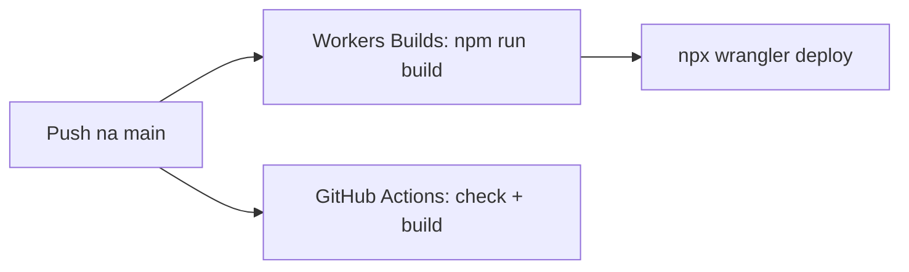

# 🚀 Guia de Deploy (Cloudflare Workers)

O site roda na Cloudflare como um **Worker com static assets**, publicado com o
[Wrangler](https://developers.cloudflare.com/workers/wrangler/). O build usa o
`@sveltejs/adapter-cloudflare`, que gera `.svelte-kit/cloudflare/` com:

- páginas pré-renderizadas (`index.html`, `blog.html`, `blog/*.html`, `sitemap.xml`) e assets estáticos,
  servidos direto pela Cloudflare sem invocar o Worker;
- `_worker.js`: o servidor do SvelteKit (só roda para rotas que não são arquivos estáticos, ex.: 404);
- `_headers`: cache imutável para `/_app/immutable/*`.

A configuração fica em [`wrangler.jsonc`](./wrangler.jsonc) (`main` + `assets`).

> Requer **Node.js 22+** (exigência do Wrangler 4), fixado no [`.nvmrc`](./.nvmrc).

## Deploy automático (Workers Builds)

O Worker está conectado ao repositório no GitHub: **todo push na `main` faz build e deploy de produção**.

Configuração no dashboard (**Workers & Pages > calebe-dev > Settings > Build**):

- **Build command**: `npm run build`
- **Deploy command**: `npx wrangler deploy`

O GitHub Actions ([`deploy.yml`](./.github/workflows/deploy.yml)) roda apenas `check` + `build` em push e PR.

### Domínio próprio

Em **Workers & Pages > calebe-dev > Settings > Domains & Routes > Add > Custom domain**, adicione
`calebearaujo.com.br` (e `www.calebearaujo.com.br`, se quiser). O domínio precisa estar com o DNS na Cloudflare.

## Desenvolvimento local

```bash
# Dev server com HMR (Vite)
npm run dev

# Build + servir no runtime real da Cloudflare (workerd), em http://localhost:8787
npm run preview
```

## Deploy manual (opcional)

Normalmente não é necessário (o push na `main` já publica), mas dá para publicar direto da máquina:

```bash
# Uma vez: autenticar (ou definir CLOUDFLARE_API_TOKEN / CLOUDFLARE_ACCOUNT_ID no .env)
npx wrangler login

# Build + deploy
npm run deploy
```

### Rollback

```bash
# Lista as versões publicadas
npx wrangler deployments list

# Volta para a versão anterior (ou passe um version-id)
npm run rollback
npm run rollback -- <version-id>
```

Também é possível pelo dashboard: **Workers & Pages > calebe-dev > Deployments**.

### Login falhando (`No CSRF value available in the session cookie`)

O navegador aberto pelo `wrangler login` não tem a sessão do dashboard (ou bloqueia cookies).
Entre em https://dash.cloudflare.com nesse navegador e tente de novo, ou use
`npx wrangler login --browser=false` e abra o link no navegador onde você já está logado.
Alternativa: crie um API token (**My Profile > API Tokens**, template *Edit Cloudflare Workers*)
e salve `CLOUDFLARE_API_TOKEN` e `CLOUDFLARE_ACCOUNT_ID` no `.env` (ignorado pelo git).

## Variáveis de ambiente e bindings

- **Variáveis/segredos de runtime**: declare em `vars` no `wrangler.jsonc` ou use
  `npx wrangler secret put NOME`. Para desenvolvimento local, use um arquivo `.dev.vars` (ignorado pelo git).
- **Bindings** (KV, D1, R2...): declare no `wrangler.jsonc` e tipe em `App.Platform['env']`
  no [`src/app.d.ts`](./src/app.d.ts). Ficam acessíveis em `platform.env` nos `load`/endpoints do servidor.

## Troubleshooting

### Ver deploys e logs
```bash
npx wrangler deployments list
npx wrangler tail   # logs em tempo real do Worker
```

- Build/deploy: **Workers & Pages > calebe-dev > Deployments > View build**
- CI no GitHub: `Actions > CI - Build & Test > latest run`

### Build falha em "updating repository submodules"
Algum diretório foi commitado como submódulo sem `.gitmodules` (repositório git aninhado).
Encontre com `git ls-files -s | grep ^160000` e remova com `git rm --cached <caminho>`.

### Build falha com `404 /algum-arquivo (linked from /)`
O prerender segue links internos (inclusive `og:image`) e falha se o arquivo não existir em `static/`.

## CI/CD Pipeline


