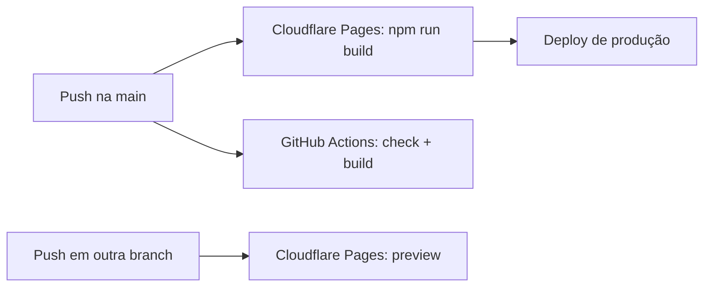

# 🚀 Guia de Deploy (Cloudflare Pages)

O site é publicado no **Cloudflare Pages** via [Wrangler](https://developers.cloudflare.com/workers/wrangler/).
O build usa o `@sveltejs/adapter-cloudflare`, que gera `.svelte-kit/cloudflare/` com:

- páginas pré-renderizadas (`index.html`, `blog.html`, `blog/*.html`, `sitemap.xml`) e assets estáticos;
- `_worker.js`: Pages Function com o servidor do SvelteKit (só é invocada para rotas não pré-renderizadas);
- `_routes.json` / `_headers`: roteamento e cache gerados automaticamente.

A configuração do projeto fica em [`wrangler.jsonc`](./wrangler.jsonc).

> Requer **Node.js 22+** (exigência do Wrangler 4), fixado no [`.nvmrc`](./.nvmrc).

## Deploy automático (integração com o GitHub)

O projeto no Cloudflare Pages está conectado ao repositório: **todo push na `main` gera um deploy
de produção**, e pushes em outras branches geram previews em `<branch>.calebe-dev.pages.dev`.

Configuração do build no dashboard (**Workers & Pages > projeto > Settings > Build**):

- **Build command**: `npm run build`
- **Build output directory**: `.svelte-kit/cloudflare` (o `pages_build_output_dir` do `wrangler.jsonc` prevalece)
- **Node.js**: lido do `.nvmrc` (22)

> O campo `name` do `wrangler.jsonc` deve ser igual ao nome do projeto no dashboard.

O GitHub Actions ([`deploy.yml`](./.github/workflows/deploy.yml)) roda apenas `check` + `build` em push e PR.

### Domínio próprio

Em **Workers & Pages > calebe-dev > Custom domains**, adicione `calebearaujo.com.br`.
Se o DNS do domínio já estiver na Cloudflare, o registro é criado automaticamente;
caso contrário, crie um `CNAME` apontando para `calebe-dev.pages.dev`.

## Desenvolvimento local

```bash
# Dev server com HMR (Vite)
npm run dev

# Build + servir no runtime real da Cloudflare (workerd), em http://localhost:8788
npm run preview
```

## Deploy manual (opcional)

Normalmente não é necessário (o push na `main` já publica), mas dá para publicar direto da máquina:

```bash
# Uma vez: autenticar (ou definir CLOUDFLARE_API_TOKEN / CLOUDFLARE_ACCOUNT_ID no .env)
npx wrangler login

# Build + deploy
npm run deploy
```

O `wrangler pages deploy` usa a branch atual do git: a partir da `main` o deploy vai para **produção**;
de qualquer outra branch vira um **preview** em `<branch>.calebe-dev.pages.dev`.

### Rollback

```bash
# Volta produção para o deploy anterior ao atual
npm run rollback

# Ou para um deploy específico
npx wrangler pages deployment list
npm run rollback -- <deployment-id>
```

O rollback usa a sessão do `wrangler login` ou as variáveis `CLOUDFLARE_API_TOKEN` / `CLOUDFLARE_ACCOUNT_ID`.
Também é possível fazer pelo dashboard: **Workers & Pages > calebe-dev > Deployments > ⋯ > Rollback**.

### Login falhando (`No CSRF value available in the session cookie`)

O navegador aberto pelo `wrangler login` não tem a sessão do dashboard (ou bloqueia cookies).
Entre em https://dash.cloudflare.com nesse navegador e tente de novo, ou use
`npx wrangler login --browser=false` e abra o link no navegador onde você já está logado.
Alternativa: crie um API token (**My Profile > API Tokens**, permissão `Account > Cloudflare Pages > Edit`)
e salve `CLOUDFLARE_API_TOKEN` e `CLOUDFLARE_ACCOUNT_ID` no `.env` (ignorado pelo git).

## Variáveis de ambiente e bindings

- **Variáveis/segredos de runtime**: defina no dashboard (**Settings > Variables and Secrets**) ou com
  `npx wrangler pages secret put NOME`. Para desenvolvimento local, use um arquivo `.dev.vars` (ignorado pelo git).
- **Bindings** (KV, D1, R2...): declare no `wrangler.jsonc` e rode `npm run cf-typegen` para atualizar
  o tipo `Env`. Eles ficam acessíveis em `platform.env` nos `load`/endpoints do lado do servidor.

## Troubleshooting

### Ver deploys e logs
```bash
npx wrangler pages deployment list
npx wrangler pages deployment tail   # logs em tempo real da Function
```

### Ver logs do build/deploy
- Cloudflare: **Workers & Pages > projeto > Deployments > (deploy) > View details**
- CI no GitHub: `Actions > CI - Build & Test > latest run`

### Build falha em "updating repository submodules"
Algum diretório foi commitado como submódulo sem `.gitmodules` (repositório git aninhado).
Encontre com `git ls-files -s | grep ^160000` e remova com `git rm --cached <caminho>`.

## CI/CD Pipeline


